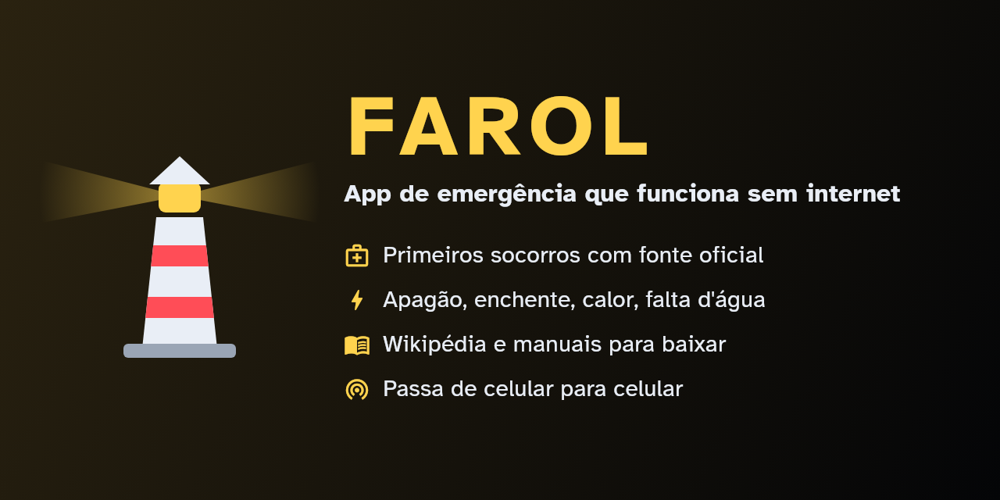
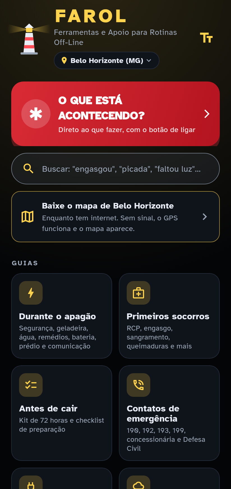
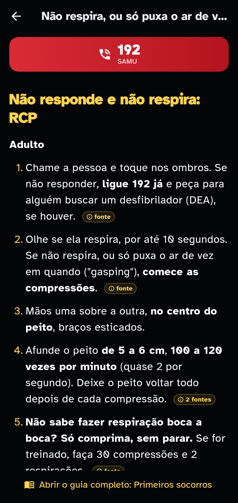
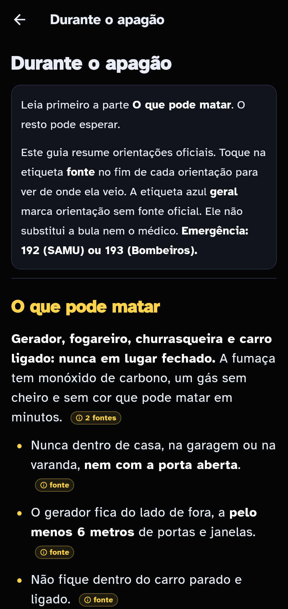
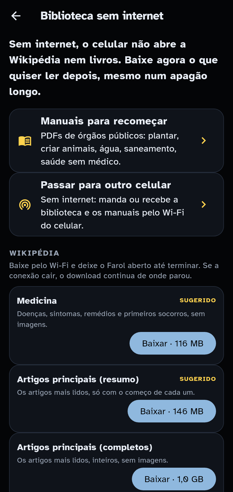
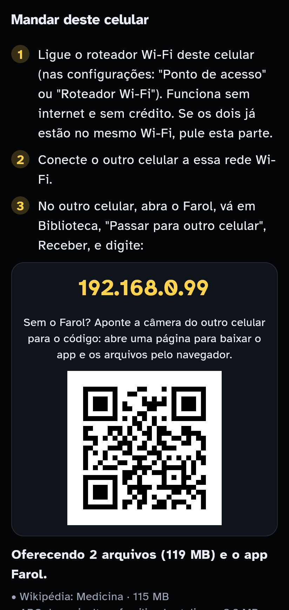

<p align="center"></p>

# FAROL

**Ferramentas e Apoio para Rotinas Off-Line**

[](LICENSE) [](conteudo/LICENSE.md)   

App de emergência **gratuito, de código aberto e que funciona sem internet**, para **apagão**, **enchente**, **deslizamento**, **calor extremo**, **falta d'água** e outros desastres no Brasil. Traz **primeiros socorros** (RCP, engasgo, sangramento, queimadura) com a fonte oficial de cada orientação, os **telefones de emergência** da sua cidade (SAMU 192, Bombeiros 193, Defesa Civil 199, concessionária de energia), **kit de emergência** com checklist e uma **biblioteca offline** com Wikipédia, livros e manuais para baixar.

Prioridade para o celular: num apagão de dias, o que fica ligado é o celular com um powerbank.

<p align="center">
  
  
  
  
  
</p>

- **Plataformas:** Android primeiro. O mesmo código gera Windows, Linux, macOS e web (PWA); iOS depois.
- **Idioma:** português do Brasil.
- **Instalar (Android):** baixe o APK na [página de versões](https://github.com/rubemkalebe/farol/releases/latest) (`arm64` serve para a maioria dos celulares; `armv7` para os mais antigos) ou receba de quem já tem: o Farol passa a si mesmo de celular para celular, sem internet.
- **Código aberto:** use, adapte para a sua cidade ou contribua (veja [Contribuir](#contribuir)).

### Por que o Farol

- **Tudo funciona sem sinal:** os guias e os telefones vêm dentro do app. Internet só para baixar extras, quando a pessoa pede, e para conferir uma vez por semana se saiu versão nova (só consulta a página pública de versões no GitHub, sem mandar nada seu).
- **Fonte oficial em cada orientação:** Ministério da Saúde, Defesa Civil, Corpo de Bombeiros, Sociedade Brasileira de Pediatria, CDC e NHS. Toque em "fonte" e veja de onde veio.
- **Para a hora do aperto:** o botão "O que está acontecendo?" leva direto ao que fazer, com botão grande de ligar, e a busca entende o jeito que a gente fala ("engasgou", "picou", "faltou luz").
- **Para um apagão longo:** Wikipédia (Medicina e mais), livros em domínio público, guias de conserto e manuais da Embrapa, Funasa e Ministério da Saúde para plantar, tratar água e construir.
- **Passa adiante sem internet:** o app e a biblioteca vão de um celular para o outro pelo Wi-Fi do próprio celular.
- **Sem conta, sem anúncio, sem rastreio:** a ficha da família fica só no aparelho.

## Acessibilidade

- Fonte **Atkinson Hyperlegible** (Braille Institute, SIL OFL), feita para quem enxerga mal, embutida no app.
- **Tamanho da letra** no próprio app (Normal, Grande, Muito grande), somado ao tamanho escolhido no celular. Com letra grande, as telas viram uma coluna só e os botões de ligar ficam empilhados.
- Cores com contraste conferido pela WCAG: texto ≥ 4,5:1, contornos de campos ≥ 3:1.
- Nomes para leitor de tela (TalkBack, VoiceOver) nos botões de emergência e de ligar.
- Testes abrem as telas principais num celular comum com a letra no máximo e falham se algo estourar a tela.

## Organização

| Pasta | O que tem |
|---|---|
| `conteudo/` | Os guias, em Markdown. O app só exibe. Para corrigir um texto, não é preciso mexer no código. |
| `locais/` | Telefones e serviços por cidade, em camadas: padrão, estado, empresa e cidade. Veja `CONTRIBUTING.md`. |
| `fontes/` | Catálogo das fontes oficiais usadas (`fontes.yaml`) e cópias quando a licença permite. Veja `fontes/README.md`. |
| `ferramentas/` | `conferir_telefones.py`: confere se cada telefone aparece na fonte citada. |
| `lib/` | O app Flutter. |

## Conteúdo

O núcleo vem sempre instalado e é pequeno:

1. Durante o apagão: bateria, geladeira, água, remédios, segurança, comunicação
2. Primeiros socorros
3. Antes de cair: kit de 72 horas e checklist
4. Contatos de emergência e ficha da família (a ficha fica só no aparelho)
5. Quando a energia voltar
6. Outros desastres: enchente, deslizamento, tempestade, calor, fumaça, falta d'água

Para a hora do aperto: o botão **"O que está acontecendo?"** leva direto ao trecho certo do guia, com botão grande de ligar 192 ou 193, e a **busca** entende o jeito que a gente fala ("engasgou", "picou", "faltou luz"). O roteiro fica em `conteudo/emergencia.yaml` e os sinônimos em `conteudo/sinonimos.yaml`.

Ferramentas no app: **Ficha da família** (tipo sanguíneo, alergias, remédios e contatos, salva só no aparelho), **checklists** que ficam marcadas e **números que ligam com um toque**.

**Folha para imprimir:** um PDF com os telefones da cidade e, se a pessoa quiser, a Ficha da família, para imprimir ou mandar alguém imprimir.

**Passar o Farol adiante** (Android): o app manda a si mesmo, como arquivo .apk, para outro celular por Quick Share ou Bluetooth, sem internet.

**Passar a biblioteca para outro celular:** sem internet, um celular manda para o outro os pacotes da biblioteca e os manuais já baixados, pelo roteador Wi-Fi do próprio celular ou por um Wi-Fi em comum. O que manda mostra um endereço; o que recebe digita esse endereço no Farol, e cada arquivo é conferido ao chegar (o MD5 que vem dentro do ZIM; o começo do PDF). Se a conexão cair, continua de onde parou. Quem ainda não tem o Farol lê um QR code com a câmera e baixa o app e os arquivos pelo navegador. O servidor só entrega os arquivos da lista e fica ligado só enquanto a tela "Mandar" está aberta.

**Onde ser atendido:** hospitais com pronto-socorro e UPAs 24 horas de cada cidade, com telefone e um botão que abre o endereço no app de mapas do celular.

**Mapa sem internet:** o Farol não tem mapa próprio. Ele indica o Organic Maps (livre, com rota a pé, de bicicleta e de carro sem internet), ensina a baixar a região, as vizinhas e o caminho até a família, e lembra de conferir de tempos em tempos. Google Maps e Mapas da Apple ficam como alternativa.

**Sair de casa:** quando sair, mochila de emergência, o que fazer antes de fechar a porta, abrigo, estrada e carro na água, reencontrar a família e atravessar a fronteira (documentos no Mercosul e autorização de viagem para crianças).

**Emergência no próprio celular:** como pôr as informações médicas na tela de bloqueio, configurar o SOS de emergência e compartilhar a localização com a família, no Android, no Samsung e no iPhone.

**Aviso de versão nova:** quem instalou o APK vê um aviso quando sai versão nova e baixa pela página de versões; instala por cima sem perder nada.

**Biblioteca sem internet:** o app baixa, a pedido, pacotes em português feitos pelo Kiwix e lê tudo sem internet. Wikipédia (Medicina, 116 MB; artigos principais; a Wikipédia inteira), com busca pelo título também na busca geral. E uma biblioteca para um apagão longo: Vikidia (enciclopédia para crianças), quase mil livros em domínio público do Projeto Gutenberg, Wikilivros, Wikiversidade, Wikivoyage, Wikcionário e Wikisource. Em inglês, a Appropedia (tecnologia simples: água, energia solar, saneamento), os guias de conserto do iFixit (3,4 GB, menu em português) e a Low-tech Magazine (uns 500 artigos sobre viver com pouca energia). Nos pacotes que trazem fotos (Vikidia, Appropedia), o leitor mostra as imagens. O leitor do formato ZIM é do próprio Farol, em Dart, sem app extra.

**Manuais para recomeçar:** uma estante de PDFs gratuitos de órgãos públicos e instituições reconhecidas (Embrapa, Funasa, Ministério da Saúde, FAO, USP, ASA, UFV, Celesc): horta, milho, feijão, mandioca, sementes, galinhas, cabras, conservas, secador solar, tratamento de água, cisterna, fossa séptica, construção, fogão a lenha e aquecedor solar. O app baixa cada PDF direto do site de quem publicou, sem copiar nem alterar, e lê no próprio Farol, lembrando a página onde a pessoa parou. A lista fica em `conteudo/estante.yaml`, com a licença de cada manual.

Em estudo: manuais oficiais completos e livros em domínio público.

> **Aviso:** o Farol resume orientações de órgãos oficiais e cita a fonte de cada uma. Ele não substitui atendimento médico nem as instruções das autoridades locais. Em emergência, ligue 192 (SAMU) ou 193 (Bombeiros).

## Contribuir

Número errado ou faltando? Abra uma issue com o formulário **"Sugerir número ou correção"**. Para adicionar uma cidade, veja `CONTRIBUTING.md`.

## Rodar

```sh
flutter pub get
flutter run            # escolhe o dispositivo conectado
flutter build apk      # APK para instalar à mão no Android
```

## Licenças

- Código: MIT (`LICENSE`)
- Textos em `conteudo/`: CC BY-SA 4.0 (`conteudo/LICENSE.md`)
- Materiais de terceiros: licença dos autores, registrada em `fontes/fontes.yaml`
- Pacotes da biblioteca: baixados do Kiwix direto no aparelho (não ficam no repositório). Projetos Wiki em CC BY-SA (Vikidia 3.0, os demais 4.0, Appropedia incluída); livros do Projeto Gutenberg em domínio público; guias do iFixit em CC BY-NC-SA 3.0 (uso não comercial, como o Farol)
- Manuais para recomeçar: não ficam no repositório; cada um segue a licença de quem publicou (anotada em `conteudo/estante.yaml`) e é baixado do site oficial.

## In English

**Farol** ("lighthouse") is a free, open-source **offline emergency app** for Brazil, written in Flutter. It works with no internet or cell signal during **blackouts**, **floods**, **landslides**, **heat waves** and **water outages**. It bundles **first aid** guides (CPR, choking, bleeding, burns), each step linked to its official source (Brazilian Ministry of Health, Civil Defense, CDC, NHS…), **local emergency phone numbers** per city, a 72-hour **emergency kit** checklist and a family medical card stored only on the device. An optional **offline library** downloads Wikipedia, Project Gutenberg books, iFixit repair guides, Appropedia and public-domain manuals (farming, water treatment, sanitation) through a pure-Dart **ZIM (Kiwix) reader**. Phones can pass the app and the library to each other over a local Wi-Fi hotspot, with no internet. The content is in Brazilian Portuguese; code is MIT, texts are CC BY-SA 4.0.

